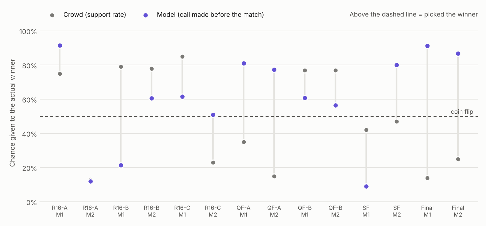
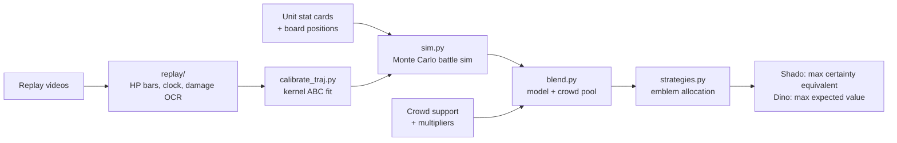

# Predictive Victory Dynamics: beating the crowd with a battle simulator

A quantitative betting model for Genshin Impact's *Predictive Victory Dynamics* event (Oct 12–19, 2026). Players stake Victory Emblems on one of two auto-battling armies, and the less popular side pays a higher multiplier. This project built a Monte Carlo battle simulator from each unit's stat card, fitted it to frame-by-frame readings of every replay, and used it to find the sides the crowd under-rated.

## Result

<picture>
  <source media="(prefers-color-scheme: dark)" srcset="charts/points_by_round_dark.png">
  
</picture>

- **1st and 2nd on the friends leaderboard.** The two accounts finished on 82,500 (Dino, max expected value) and 46,450 (Shado, risk-adjusted). The best of the other friends finished on 16,600.
- **The Final made the event.** The crowd gave Mirror Fruity Order 14% and Saurians 25%. The model gave them 91% and 87%. Both won, paying ×200 and ×105: +40,000 for Dino and +27,365 for Shado in one round.

| Rank | Player | Final score |
|---|---|---|
| 1 | **Dino** (Strategy B) | 82,500 |
| 2 | **Shado** (Strategy A) | 46,450 |
| 3 | Friend 1 | 16,600 |
| 4 | Friend 2 | 16,490 |
| 5 | Friend 3 | 16,000 |

## Model vs crowd

<picture>
  <source media="(prefers-color-scheme: dark)" srcset="charts/model_vs_crowd_dark.png">
  
</picture>

Each dot is the probability a predictor gave the side that actually won. The model column uses the call made before each match, with no hindsight. The crowd column is the support rate read as a probability.

| 14 modelled matches | Correct | Mean Brier (lower is better) |
|---|---|---|
| Model (call made at the time, v1–v8) | **11 / 14** | **0.234** |
| Crowd | 6 / 14 | 0.336 |

- **Disagreements:** when the model and the crowd picked different sides, the model was right 6 times out of 7.
- **Could it be luck?** If both were coin flips, a gap of 5 or more over 14 matches happens about 4% of the time. The edge looks real, but 14 matches is a small sample.
- **Coverage:** two R16-D matches had no model call because the losing teams' unit cards were never captured. Counting them, the crowd went 8 / 16.

Full match-by-match detail is in **[RESULTS.md](RESULTS.md)**.

## How it works



1. **Simulate.** `sim.py` plays each battle thousands of times on a grid, with each unit's stats, targeting, AoE, crowd control, elemental reactions and overtime. Parameters it can't read off a card are drawn from a posterior.
2. **Calibrate.** The `replay/` tools read team HP bars, the clock, commentary and damage numbers from each replay. `calibrate_traj.py` keeps the parameter draws whose simulated HP curves match the real ones. Twelve replays were fitted by the end.
3. **Blend.** The model is pooled with the crowd's implied probability. The trust weight depends on how many of the units have been seen in replays: about 0.6 when all of them have, about 0.35 when key units haven't.
4. **Allocate.** A correct pick pays `emblems × multiplier` and a wrong pick pays `emblems × 10`. `strategies.py` searches every split of the round's emblems. Each account ran one objective, as a controlled comparison:
   - **Shado (A):** maximise `EV − (λ/2)·Var`, with λ = 2.1e-4.
   - **Dino (B):** maximise EV.

Payout asymmetry drove the results, more than disagreeing with the crowd's favourite. The biggest wins were strong teams priced as long shots.

## Documentation

| Doc | What it covers |
|---|---|
| [docs/SUMMARY.md](docs/SUMMARY.md) | Full write-up: track record with hindsight-free and backtest columns, what worked, what went wrong, points by round |
| [RESULTS.md](RESULTS.md) | Every match: crowd support, multipliers, model call, winner, picks, score (generated) |
| [docs/VERSION_HISTORY.md](docs/VERSION_HISTORY.md) | Model v1 → v8: what each version changed and how well it fit |
| [docs/MECHANICS.md](docs/MECHANICS.md) | Game rules and battle mechanics measured from replays, plus the payout table |
| [docs/DECISIONS.md](docs/DECISIONS.md) | Major decisions and their reasoning: Sharpe → CE, λ, trust weights, pacing |
| [docs/PROCESS_LOG.md](docs/PROCESS_LOG.md) | Full dated log of everything done, in order |
| [docs/SKILLS.md](docs/SKILLS.md) | Techniques used, by area |
| [docs/HANDOFF.md](docs/HANDOFF.md) | Per-round operating procedure and final state, for picking the project back up |
| [docs/rounds/](docs/rounds/) | Early per-round notes (R16-A to R16-C) |

## Reproduce

The model, calibration and backtests use only the Python standard library. The replay readers need `opencv-python`, `numpy` and `rapidocr_onnxruntime`, and the charts need `matplotlib`.

```bash
python sim.py SF                       # P(left wins), sensitivity and EV per emblem for a round
python strategies.py SF --pool 200 --lambda 2.1e-4 --linw 0.6,0.6
python loo.py                          # leave-one-out and past-only backtests
python calibrate_traj.py 3000 2        # refit to every replay outcome in data/replays/
python make_results.py                 # rebuild RESULTS.md from the CSVs
python make_charts.py                  # rebuild the charts above
```

The CSVs in `data/` are the source of truth. `RESULTS.md` and `charts/` are generated from them.

## Repo layout

```
├── README.md, RESULTS.md
├── sim.py                 Monte Carlo battle simulator (core model)
├── calibrate_traj.py      fits the sim to replay trajectories (kernel ABC) -> data/calibration_samples.csv
├── blend.py               model/crowd pooling and trust-weight checks
├── strategies.py          emblem allocation: Strategy A (CE), B (EV), benchmarks, break-evens
├── loo.py                 leave-one-out and past-only backtests
├── margin_check.py        where a real result falls in the model's own outcome distribution
├── make_results.py        builds RESULTS.md
├── make_charts.py         builds charts/
├── replay/                replay video readers: extract, observe, bars, dmg (OCR), attribute
├── charts/                README charts (light and dark)
├── data/
│   ├── matches.csv        every match: crowd, multipliers, model P, picks, winner, score, Brier
│   ├── leaderboard.csv    final friends leaderboard (other players anonymized)
│   ├── units.csv          every unit type: stats, tags, element, mechanics flags
│   ├── placements.csv     every unit's grid position per match
│   ├── crowd_log.csv      timestamped support-rate and multiplier snapshots
│   ├── unit_hits_measured.csv, calibration_samples*.csv, backtest*
│   └── replays/           per-round outcomes and extracted per-frame data
├── docs/                  write-ups (see Documentation)
└── legacy/                superseded early tools and charts, kept for history
```

*Account names:* Shado appears as "Shadow" in the older notes and the CSVs.
