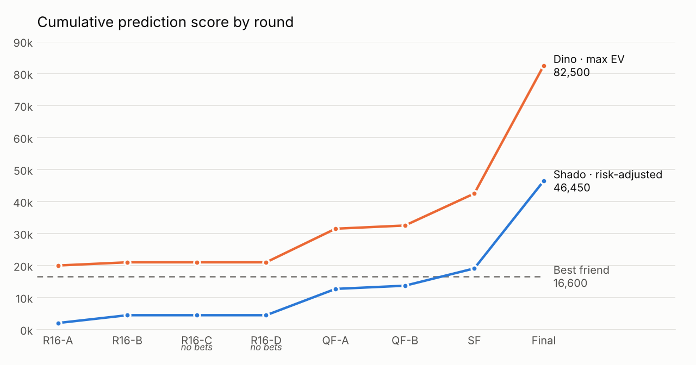
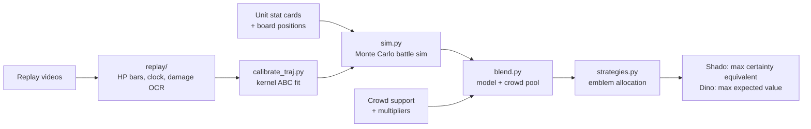

# Predictive Victory Dynamics: beating the crowd with a battle simulator

A quantitative betting model for Genshin Impact's *Predictive Victory Dynamics* event (Oct 12–19, 2026). Players stake Victory Emblems on one of two auto-battling armies, and the less popular side pays a higher multiplier. This project built a Monte Carlo battle simulator from each unit's stat card, fitted it to frame-by-frame readings of every replay, and used it to find the sides the crowd under-rated.

## Result

<picture>
  <source media="(prefers-color-scheme: dark)" srcset="charts/points_by_round_dark.png">
  
</picture>

- **1st and 2nd on the friends leaderboard.** The two accounts finished on 82,500 (Dino, max expected value) and 46,450 (Shado, risk-adjusted). The best of the other friends finished on 16,600.
- **The Final made the event.** The crowd gave Mirror Fruity Order 14% and Saurians 25%. The model gave them 91% and 87%. Both won, paying ×200 and ×105: +40,000 for Dino and +27,365 for Shado in one round.

| Rank | Player | Final score |
|---|---|---|
| 1 | **Dino** (Strategy B) | 82,500 |
| 2 | **Shado** (Strategy A) | 46,450 |
| 3 | Friend 1 | 16,600 |
| 4 | Friend 2 | 16,490 |
| 5 | Friend 3 | 16,000 |

## Track record: model vs crowd

The live model is scored against two backtests and the crowd. The backtests differ in how much look-ahead bias (information from after the match) they contain.

<!-- track-record:start -->
<!-- generated by make_results.py from data/matches.csv and data/backtest_v8.csv; do not edit by hand -->

**Scoreboard: the 14 matches with a live model call**

| Predictor | How the prediction was made | Look-ahead bias | Correct | Brier ↓ |
|---|---|---|---|---|
| **Live model** | The call actually made before the match, by the model version of the day (v1–v8) | **None**: true out-of-sample | **11 / 14** | 0.234 |
| Walk-forward backtest | Final model (v8), refit using only rounds before the match | Structural only: v8's mechanics were found by watching every replay | 13 / 14 | 0.106 |
| Leave-one-out CV | Final model (v8), refit on every other match, earlier and later | Parameter + structural: later rounds leak into the fit | 11 / 14 | 0.114 |
| Crowd | Support rate read as a win probability | None | 6 / 14 | 0.336 |

- **Live is the headline.** It is the only model row with no look-ahead bias. The two backtests show what the finished model would have called. The gap between live (11/14) and walk-forward (13/14) is roughly what the mechanics learned during the event were worth. Two of walk-forward's wins (R16-B) are 50–51% coin flips, so treat 13/14 as about 11–13.
- **Brier score** is the mean squared error of the probability (0 is perfect, 0.25 is always saying 50%). It rewards calibrated confidence, not just the right side.
- **R16-D** had no model call (the losing teams' unit cards were never captured). The crowd went 8 / 16 counting it.

**Every match**

Each model or crowd cell shows the side it favoured (L/R) and how confident it was. The winner is in bold.

| Round | Left vs Right | Live model | Walk-forward | Leave-one-out | Crowd | Winner |
|---|---|---|---|---|---|---|
| R16-A&nbsp;M1 | Howl Crew vs **Fungi Clan** | R&nbsp;92%&nbsp;✅ | R&nbsp;97%&nbsp;✅ | R&nbsp;98%&nbsp;✅ | R&nbsp;75%&nbsp;✅ | R |
| R16-A&nbsp;M2 | Frostarm & Shaman vs **Saurians** | L&nbsp;88%&nbsp;❌ | R&nbsp;88%&nbsp;✅ | R&nbsp;83%&nbsp;✅ | L&nbsp;87%&nbsp;❌ | R |
| R16-B&nbsp;M1 | Dye Experts vs **Mirror Fruity** | L&nbsp;78%&nbsp;❌ | R&nbsp;51.3%&nbsp;✅ | L&nbsp;52.0%&nbsp;❌ | R&nbsp;79%&nbsp;✅ | R |
| R16-B&nbsp;M2 | **Blazing Beasts** vs Rude-a-Lot | L&nbsp;60%&nbsp;✅ | L&nbsp;50.2%&nbsp;✅ | R&nbsp;54.0%&nbsp;❌ | L&nbsp;78%&nbsp;✅ | L |
| R16-C&nbsp;M1 | **Grenadier** vs Seahorse & Crab | L&nbsp;62%&nbsp;✅ | L&nbsp;53.2%&nbsp;✅ | L&nbsp;56%&nbsp;✅ | L&nbsp;85%&nbsp;✅ | L |
| R16-C&nbsp;M2 | **Chubby Crisis** vs Consecrated Beast | L&nbsp;51.0%&nbsp;✅ | L&nbsp;85%&nbsp;✅ | L&nbsp;88%&nbsp;✅ | R&nbsp;77%&nbsp;❌ | L |
| R16-D&nbsp;M1 | **Ninken** vs Hilichurl Fighters | — | — | — | L&nbsp;82%&nbsp;✅ | L |
| R16-D&nbsp;M2 | Ultra-Ancient vs **Round-and-Frost** | — | — | — | R&nbsp;66%&nbsp;✅ | R |
| QF-A&nbsp;M1 | **Saurians** vs Fungi Clan | L&nbsp;81%&nbsp;✅ | L&nbsp;90%&nbsp;✅ | L&nbsp;91%&nbsp;✅ | R&nbsp;65%&nbsp;❌ | L |
| QF-A&nbsp;M2 | **Mirror Fruity** vs Blazing Beasts | L&nbsp;77%&nbsp;✅ | L&nbsp;84%&nbsp;✅ | L&nbsp;80%&nbsp;✅ | R&nbsp;85%&nbsp;❌ | L |
| QF-B&nbsp;M1 | **Grenadier** vs Chubby Crisis | L&nbsp;61%&nbsp;✅ | L&nbsp;56%&nbsp;✅ | L&nbsp;54.2%&nbsp;✅ | L&nbsp;77%&nbsp;✅ | L |
| QF-B&nbsp;M2 | **Ninken** vs Round-and-Frost | L&nbsp;56%&nbsp;✅ | L&nbsp;68%&nbsp;✅ | L&nbsp;68%&nbsp;✅ | L&nbsp;77%&nbsp;✅ | L |
| SF&nbsp;M1 | Mirror Fruity vs **Saurians** | L&nbsp;91%&nbsp;❌ | L&nbsp;59%&nbsp;❌ | L&nbsp;61%&nbsp;❌ | L&nbsp;58%&nbsp;❌ | R |
| SF&nbsp;M2 | **Grenadier** vs Ninken | L&nbsp;80%&nbsp;✅ | L&nbsp;80%&nbsp;✅ | L&nbsp;79%&nbsp;✅ | R&nbsp;53.0%&nbsp;❌ | L |
| 3rd&nbsp;place | **Mirror Fruity** vs Ninken | L&nbsp;91%&nbsp;✅ | L&nbsp;92%&nbsp;✅ | L&nbsp;92%&nbsp;✅ | R&nbsp;86%&nbsp;❌ | L |
| Final | **Saurians** vs Grenadier | L&nbsp;87%&nbsp;✅ | L&nbsp;88%&nbsp;✅ | L&nbsp;88%&nbsp;✅ | R&nbsp;75%&nbsp;❌ | L |
| **Correct** | *out of the 14 matches with a model call* | **11&nbsp;/&nbsp;14** | **13&nbsp;/&nbsp;14** | **11&nbsp;/&nbsp;14** | **6&nbsp;/&nbsp;14** | 14&nbsp;/&nbsp;14 |

<!-- track-record:end -->

**Could it be luck?** If the live model and the crowd were both coin flips, a gap of 5 or more over 14 matches would happen about 4% of the time. The edge looks real, but 14 matches is a small sample. When the live model and the crowd disagreed, the model was right 6 times out of 7.

Per-match crowd support, multipliers, picks and scores are in **[RESULTS.md](RESULTS.md)**.

## How it works



1. **Simulate.** `sim.py` plays each battle thousands of times on a grid, with each unit's stats, targeting, AoE, crowd control, elemental reactions and overtime. Parameters it can't read off a card are drawn from a posterior.
2. **Calibrate.** The `replay/` tools read team HP bars, the clock, commentary and damage numbers from each replay. `calibrate_traj.py` keeps the parameter draws whose simulated HP curves match the real ones. Twelve replays were fitted by the end.
3. **Blend.** The model is pooled with the crowd's implied probability. The trust weight depends on how many of the units have been seen in replays: about 0.6 when all of them have, about 0.35 when key units haven't.
4. **Allocate.** A correct pick pays `emblems × multiplier` and a wrong pick pays `emblems × 10`. `strategies.py` searches every split of the round's emblems. Each account ran one objective, as a controlled comparison:
   - **Shado (A):** maximise `EV − (λ/2)·Var`, with λ = 2.1e-4.
   - **Dino (B):** maximise EV.

Payout asymmetry drove the results, more than disagreeing with the crowd's favourite. The biggest wins were strong teams priced as long shots.

## Documentation

| Doc | What it covers |
|---|---|
| [docs/SUMMARY.md](docs/SUMMARY.md) | Full write-up: track record with hindsight-free and backtest columns, what worked, what went wrong, points by round |
| [RESULTS.md](RESULTS.md) | Every match: crowd support, multipliers, model call, winner, picks, score (generated) |
| [docs/VERSION_HISTORY.md](docs/VERSION_HISTORY.md) | Model v1 → v8: what each version changed and how well it fit |
| [docs/MECHANICS.md](docs/MECHANICS.md) | Game rules and battle mechanics measured from replays, plus the payout table |
| [docs/DECISIONS.md](docs/DECISIONS.md) | Major decisions and their reasoning: Sharpe → CE, λ, trust weights, pacing |
| [docs/FULL_PROJECT_JOURNEY_JOURNAL.md](docs/FULL_PROJECT_JOURNEY_JOURNAL.md) | Full dated journal of the whole project journey: rounds, bets, model changes, panels, corrections and reasoning |
| [docs/SKILLS_DEVELOPED_DURING_PROJECT.md](docs/SKILLS_DEVELOPED_DURING_PROJECT.md) | Skills developed during the project, by area |
| [docs/HANDOFF.md](docs/HANDOFF.md) | Per-round operating procedure and final state, for picking the project back up |
| [docs/rounds/](docs/rounds/) | Early per-round notes (R16-A to R16-C) |

## Reproduce

The model, calibration and backtests use only the Python standard library. The replay readers need `opencv-python`, `numpy` and `rapidocr_onnxruntime`, and the charts need `matplotlib`.

```bash
python sim.py SF                       # P(left wins), sensitivity and EV per emblem for a round
python strategies.py SF --pool 200 --lambda 2.1e-4 --linw 0.6,0.6
python loo.py                          # leave-one-out and past-only backtests
python calibrate_traj.py 3000 2        # refit to every replay outcome in data/replays/
python make_results.py                 # rebuild RESULTS.md from the CSVs
python make_charts.py                  # rebuild the points chart
```

The CSVs in `data/` are the source of truth. `RESULTS.md`, `charts/` and the track-record tables are generated from them.

## Repo layout

```
├── README.md, RESULTS.md
├── sim.py                 Monte Carlo battle simulator (core model)
├── calibrate_traj.py      fits the sim to replay trajectories (kernel ABC) -> data/calibration_samples.csv
├── blend.py               model/crowd pooling and trust-weight checks
├── strategies.py          emblem allocation: Strategy A (CE), B (EV), benchmarks, break-evens
├── loo.py                 leave-one-out and past-only backtests
├── margin_check.py        where a real result falls in the model's own outcome distribution
├── make_results.py        builds RESULTS.md and the track-record tables in README and SUMMARY
├── make_charts.py         builds charts/
├── replay/                replay video readers: extract, observe, bars, dmg (OCR), attribute
├── charts/                README points chart (light and dark)
├── data/
│   ├── matches.csv        every match: crowd, multipliers, model P, picks, winner, score, Brier
│   ├── backtest_v8.csv    per-match walk-forward and leave-one-out predictions
│   ├── leaderboard.csv    final friends leaderboard (other players anonymized)
│   ├── units.csv          every unit type: stats, tags, element, mechanics flags
│   ├── placements.csv     every unit's grid position per match
│   ├── crowd_log.csv      timestamped support-rate and multiplier snapshots
│   ├── unit_hits_measured.csv, calibration_samples*.csv, backtest*
│   └── replays/           per-round outcomes and extracted per-frame data
├── docs/                  write-ups (see Documentation)
└── legacy/                superseded early tools and charts, kept for history
```

*Account names:* Shado appears as "Shadow" in the older notes and the CSVs.
